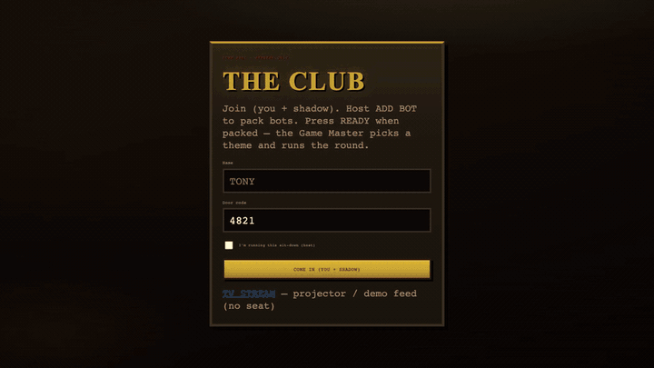
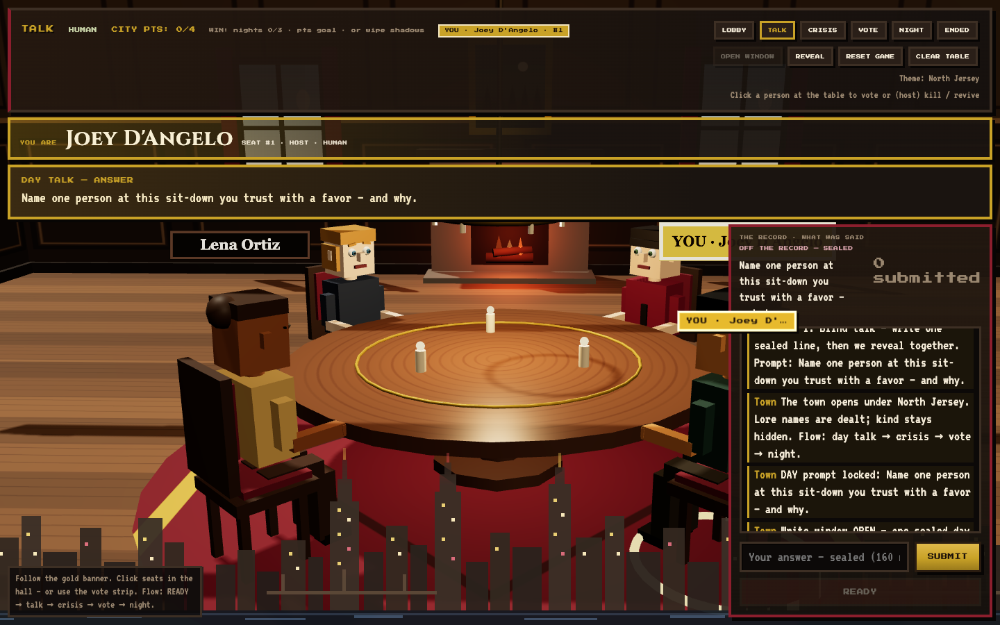
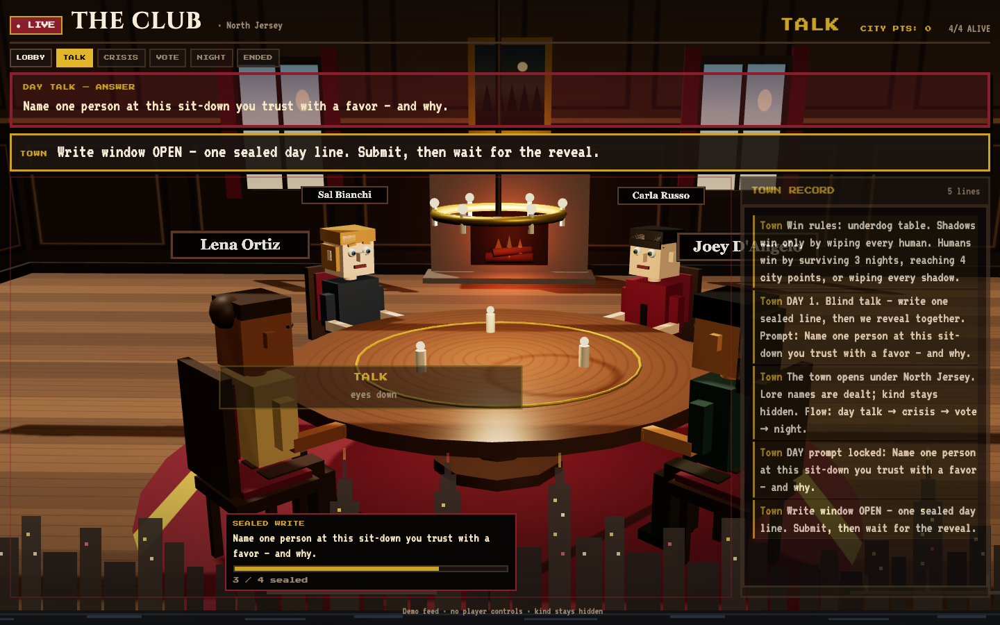

# GrokMafia — humans vs Grok at one table

**Hackathon · Wrocław · Team 1**

> Multiplayer AI isn’t one chatbot in a lobby.  
> It’s **humans and Grok bots under the same lore names** — and nobody’s view shows who’s silicon.

[](https://grokmafia-kernel.onrender.com)
[](https://grokmafia-kernel.onrender.com)
[](https://grokmafia-kernel.onrender.com/stream)

**Play now:** https://grokmafia-kernel.onrender.com · PIN **`4821`**  
**Projector:** https://grokmafia-kernel.onrender.com/stream  
**Video of demo:** https://youtu.be/IKUW3Hs-W54


*Free Render may cold-start ~30–60s — open the URL once before judging.*

<p align="center">
  
</p>
<p align="center"><em>Join → pack the table → lore deal → sealed day talk in the dining hall</em></p>

---

## For judges (2 minutes)

1. Wake the live URL (and optionally `/stream` on a second screen).
2. Join with a name + **`4821`** (tick **host** on the first machine).
3. **ADD BOT** → **READY** / **START**.
4. Watch **blind talk → crisis → vote → night**. Look for the gold **YOU ARE** card over your seat.

One join seats **you + your shadow bot**. Themes: Wild West, Space Colony, North Jersey, Deep Harbor.

---

## Why this wins the “multiagent” brief

Most demos wrap a single model. GrokMafia puts bots on the **same Player API, same table, same win conditions** as humans:

- **Kind is hidden** — no bot badges in the hall.
- **Bots know they are bots**, never confess, and must cooperate at night as reshuffled **Shadow A/B/…** without learning seats.
- An LLM **Game Master** runs prompts + tempo; a **crisis judge** awards city points that can block a night kill.

It’s a playable social-deduction loop, not a chat wrapper.

---

<p align="center">
  
</p>
<p align="center"><em>Player UI — identity card, sealed prompt, Three.js sit-down</em></p>

<p align="center">
  
</p>
<p align="center"><em>TV /stream — public-only feed for demos (no private kind / shadow chat)</em></p>

---

## Round loop

| Phase | What happens |
|--------|----------------|
| **Lobby** | Pairs join. Host packs bots / theme. READY / START. |
| **Day talk** | One **sealed** line each → batch reveal. Theme-aware prompts. |
| **Crisis** | Soft stakes: LLM judge → **city points** + real **tempo** (longer/shorter windows). Nobody dies. |
| **Vote** | Remove a seat. **Kind stays hidden.** |
| **Night** | Shadows talk privately, strike a human (or pass). Spend **1 city point** to block. |
| **Win** | Humans: wipe bots, survive nights, or hit the point goal. Bots: wipe humans (dead bots still share the win). |

---

## What shipped

- **3D dining hall** (Three.js) + vote strip on smaller screens  
- **`/stream` TV mode** for projectors  
- **Grok bots** with seeded personalities + full public transcript  
- **GM auto-advance**, host overrides for live demos  
- **Session resume** after refresh  
- Kernel: **Room / Player / Rules / Views** (TownRules = product; SandboxRules proves the kernel)

---

## Stack

`Node` · `Express` · `Socket.IO` · `Three.js` · `xAI Grok` (optional — canned fallbacks offline)

```bash
npm install && npm start   # http://127.0.0.1:3000
npm test
```

| Env | Purpose |
|-----|---------|
| `JOIN_PIN` | Door code (demo `4821`) |
| `GROK_API_KEY` | Live bots / judge / GM prompts |
| `GM_AUTO=0` | Disable auto phase advance |
| `HOST` / `PORT` | Deploy bind |

Product lock: [`docs/locked-loop-v1.md`](docs/locked-loop-v1.md) · Pitch: [`docs/pitch-v0.md`](docs/pitch-v0.md)

---

## Team

Hackathon Wrocław — Team 1 · `master`

<details>
<summary>Maintainer deploy</summary>

**Render:** `render.yaml` Blueprint · set `JOIN_PIN` + optional `GROK_API_KEY`.  
**Docker:** `docker build -t grokmafia . && docker run --rm -p 3000:3000 -e JOIN_PIN=4821 -e GROK_API_KEY=$GROK_API_KEY grokmafia`

Recapture media (optional):

```bash
PORT=3030 node server/index.js
npm install --no-save playwright && npx playwright install ffmpeg
node scripts/capture-screenshots.mjs http://127.0.0.1:3030
node scripts/capture-gif.mjs http://127.0.0.1:3030
```

</details>
