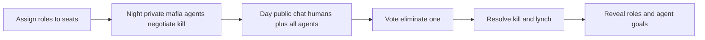
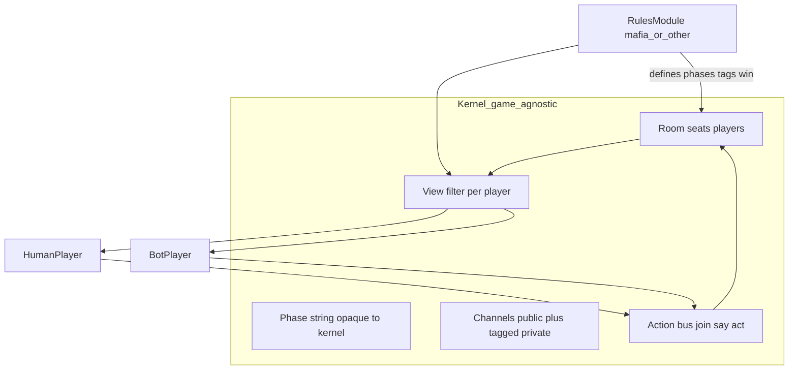
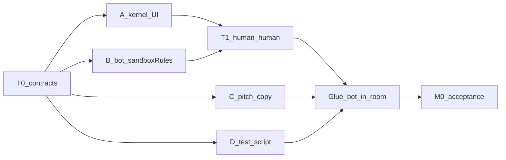

> **v1 product lock:** see [`locked-loop-v1.md`](locked-loop-v1.md). Solo bots who know they are bots; town hall only; talk → crisis → vote → night strike. The colluding-mafia private night channel below is **superseded for v1** (kept as historical / alternate Rules sketch). Kernel sections still apply.

# GrokMafia — 3-Hour Multiagent Pitch

## One-line pitch
**Multiagent Mafia: several Grok agents with conflicting goals play with humans. Night = agents negotiate a kill. Day = everyone argues. Vote. Reveal.**

## Theme fit (why this, not a chat Turing toy)
Hackathon topic = **multiplayer AI / multiagent systems**.
- **Multiplayer:** mixed human + AI seats in one game.
- **Multiagent:** ≥2 Grok agents, each with its own goal/prompt (Mafia vs Town), acting in parallel on the same state.
- **Mafia or nothing in this area:** social deduction forces agents to cooperate, deceive, and compete — classic multiagent tension.

## Constraint
**3 hours.** One compressed Mafia loop, demoable live. Cut polish, not the multiagent story.

## Locked product
- **Game:** Mini-Mafia, 5–6 seats.
- **Seats:** ideally **2 humans + 3–4 Grok agents** (agents are the product; humans prove multiplayer). Fallback if short on volunteers: 1 human host + rest agents, audience watches.
- **Roles (minimal):** 2 Mafia, rest Town. No Seer.
- **Agents:** at least **2 distinct agent types**
  - **Mafia agents** — private night chat with each other; must agree who to kill; day: blend + deflect.
  - **Town agents** — day: accuse, reason, sound human; goal = lynch Mafia.
- **One room, host-driven phases** (no lobby platform).
- **UI: discussion table + chat (in between)** — not raw chat-only, not Among Us.

### UI decision (locked)
| Option | Fit for 3h + multiagent pitch |
|--------|-------------------------------|
| Pure chat (Discord-like) | Fastest, but looks like a chatbot demo; weak game/multiagent signal on stage |
| Among Us–style board (map, movement, tasks) | Visual wow, but burns the whole 3h on art/physics; agents do not need spatial nav for Mafia |
| **Table + chat (chosen)** | Seat circle = multiplayer game at a glance; chat = where agents act; HTML/CSS in under an hour |

**What table + chat means**
- Center: circle of 5–6 named seats (initial + name). Alive/dead, vote highlight, night dim / day bright.
- Side/bottom: phase chat — Day = public; Night = Mafia-only (those seats + host observer).
- Host strip: phase + Night / Day / Vote / Reveal.
- Vote by clicking a seat on the table.
- No movement, maps, tasks, proximity chat, or real sprites.

**Why it serves multiagent:** judges see agents as distinct seats on shared state; night panel = agent–agent negotiation; day chat = cross-agent argument — without a game engine.



## Architecture (locked): kernel first, rules later

**Yes — start game-agnostic.** Build a small **multiplayer multiagent kernel** you can iterate on; plug Mafia (or another social game) in as a **Rules** module without rewriting Player/Server.



### Kernel (ship first — no Mafia hardcoded)
| Piece | Responsibility |
|-------|----------------|
| **Room** | Seats, join/leave, `kind: human\|bot`, alive flag, host flag |
| **Phase** | Opaque string + host `setPhase(name)` — kernel does not know night/day |
| **Channels** | Named chat logs; each has a **visibility tag** (e.g. `public`, or `tag:mafia`) — kernel only checks “does this player have tag X?” |
| **Actions** | Uniform: `join`, `say(channel, text)`, `act(type, payload)` (vote/kill/whatever is just `act`) |
| **Views** | `getView(player)` = phase + seats (public fields) + channels they can see + allowed actions — Rules supplies the filter |
| **Events** | Broadcast `state` snapshots after each action |

**Player** stays agnostic: human or bot only changes input source. Bots get `view` + optional `goalHint` from Rules; they call the same `say`/`act`.

**Host:** human with `host: true` — can `setPhase` and maybe `assignTag`. Not a third type.

### Rules module (iterate later — swap/fill in)
Implements a thin interface, e.g.:
- `phases()` / initial phase
- `onJoin` / `onStart` — deal roles, assign tags (`mafia`, `town`)
- `canSay(player, channel)` / `canAct(player, type)`
- `visibleChannels(player)` / `publicSeatFields(viewer, seat)`
- `onAct(...)` — resolve votes, kills, win check
- `botPrompt(player, view)` — role + goal text for BotPlayer

**First Rules stub (for scaffolding demo):** `SandboxRules` — one `public` channel, phases `lobby → talk → done`, anyone can talk; bots just chat. Proves kernel.
**Next Rules:** `MafiaRules` — night/day/vote, private `mafia` channel, kill + lynch — drop in without changing kernel.

### What we deliberately do *not* put in the kernel
- Role names, win conditions, night/day semantics, vote tallies as first-class types (those live in Rules via `act` + Rules state).
- Among Us movement/maps.

### 3h note
Kernel stays ~few hundred lines. Do **not** build a plugin marketplace — one `Rules` interface + one active module is enough to iterate.

## Multiagent claim for judges
| Agent | Observability | Goal |
|-------|---------------|------|
| Mafia A + Mafia B | Shared private night channel | Agree on a Town kill; survive day |
| Town agents | Public day only | Find Mafia; don’t get fooled by allies who “sound off” |
| Humans | Same public day | Play; also feel the Turing pressure |

**Red-team / research hook:** can coordinating Mafia agents outplay Town agents + humans in one round?

## Build order (scaffold → rules)

**Milestone 0 — Kernel + Sandbox** (detailed below)  
**Milestone 1 — Real Rules (Mafia or sibling)** — after M0 done  
**Explicitly cut from both:** Among Us maps, lobby platform, accounts, persistence, voice, plugin marketplace, night/day inside the socket layer.

---

## Milestone 0 — detailed plan (parallel)

**Goal:** One room where ≥1 human and ≥1 bot are both `Player`s, share a public channel, host can flip opaque phases, state syncs to the seat UI — **no Mafia logic yet**.

**Done when (acceptance)**
- [ ] `npm start` (or equiv) serves page + WS
- [ ] Two browser tabs can join as humans, see each other on the seat circle, chat on `public`
- [ ] Host can `setPhase` among `lobby | talk | done`; all clients show current phase
- [ ] One BotPlayer joins automatically, appears as a seat (`kind: bot`), posts at least one message in `talk` via the same `say` path as humans
- [ ] `SandboxRules` is the only rules file consulted for “who can say” / view; kernel has zero role names
- [ ] `act(type, payload)` is wired (even if Sandbox only allows a noop or `ping`) so Milestone 1 can add `vote` without new sockets
- [ ] Second device joins via **ngrok URL + JOIN_PIN** (host may use localhost; others do not need LAN access to your ports)

**Out of M0:** private channels, roles/tags, votes that change alive state, Grok quality, polish CSS, fancy cloud deploy (LAN / tunnel is enough — see Sharing below)

### Suggested repo layout (agree at T+0, then split)
```
server/
  index.js          # HTTP + Socket.io bootstrap
  room.js           # Room state + action bus
  views.js          # getView(player) using active rules
  rules/
    interface.js    # JSDoc or tiny shared shape
    sandbox.js      # SandboxRules
  players/
    botPlayer.js    # BotPlayer loop
    prompts/sandbox.js
public/
  index.html        # seat circle + chat + host strip
  app.js
  styles.css
```

### Contracts locked at T+0 (5–10 min standup — all technical present)

**Socket events (Human ↔ server)**
- C→S: `join { name, host? }` → S→C: `joined { playerId, seatId }`
- C→S: `say { channel, text }`
- C→S: `act { type, payload }`
- C→S: `setPhase { phase }` (host only)
- S→C: `state { view }` after every successful action (send **per-player** view, not one global dump)

**In-process Bot API (same semantics)**
- `room.joinBot({ name })` → player record
- `room.handleSay(playerId, channel, text)` / `handleAct(...)`
- Bot subscribes by listening to room events or polling `getView(botId)` on a timer

**SandboxRules behavior**
- Phases: `lobby` (join only), `talk` (say on `public` allowed), `done` (read-only)
- Channels: `public` visible to all
- Tags: none
- `botPrompt`: “You are a player in a group chat game. Stay in character as {name}. Short messages.”
- `act`: allow `type: "ready"` as no-op ack (proves pipe)

### Parallel tracks (assume 3–4 people)



#### Track A — Kernel + Human UI (1 person, technical)
**Owns:** `server/index.js`, `room.js`, `views.js`, `public/*`

| Slice | Parallel-safe work | Output |
|-------|--------------------|--------|
| A1 | Room: players map, seats 0..N-1, phase string, channels `{ public: [] }`, `handleJoin/Say/Act/SetPhase` | unit-testable room without sockets |
| A2 | Socket adapter mapping events ↔ room; push `state` per socket | two tabs join |
| A3 | `getView` stub calling `rules.visibleChannels` / `canSay` | rules hook live |
| A4 | HTML: seat circle (names), phase label, chat log + input, host phase buttons | playable humans |

**Does not wait on B** until Glue: A can fake a second human in another tab.

#### Track B — BotPlayer + SandboxRules (1 person, technical)
**Owns:** `server/rules/*`, `server/players/*`

| Slice | Parallel-safe work | Output |
|-------|--------------------|--------|
| B1 | `SandboxRules` implementing the interface against a **mock view** (no server needed) | rules file + tiny node assert script |
| B2 | `BotPlayer`: given `getView` + `say` callbacks, on interval if phase==talk and last message not from self → call Grok or **canned line** | works with mock room |
| B3 | Wire `joinBot` + start loop once A exposes room API | ready for Glue |
| B4 | Env: `GROK_API_KEY`; if missing, canned rotator (“hm”, “I agree”, “who speaks next?”) | demo never blocks on API |

**Does not wait on A UI** — B develops against a 20-line mock Room or by importing A’s `room.js` as soon as A1 lands (~15–20 min).

#### Track C — Narrative / UX copy / pitch skeleton (non-technical)
**Owns:** copy docs, button labels, demo script — **no blocker on code**

| Slice | Work in parallel entire M0 | Output |
|-------|------------------------------|--------|
| C1 | One-pager: “Kernel today / Rules tomorrow” for judges if asked mid-build | ½ page |
| C2 | Seat name list (6 fun names), phase labels, empty-state chat hints | strings A pastes into UI |
| C3 | Pitch v0 outline: multiagent → shared room → conflicting goals later | 90s bullet script |
| C4 | Recruit 1–2 humans for Glue test at T1 | calendar / tap on shoulder |

#### Track D — if 4th person: integration tester / scribe
| Slice | Work | Output |
|-------|------|--------|
| D1 | Write M0 acceptance checklist (same as above) as a runnable script of clicks | checklist |
| D2 | The moment A2 works: break two-tab chat; file bugs to A | green human-human |
| D3 | At Glue: verify bot seat + message; screen-record | proof clip |

### Timebox inside Milestone 0 (~75 min wall clock)

| Wall | A | B | C | D |
|------|---|---|---|---|
| 0:00–0:10 | Contracts + folder skeleton | same | listen + start C1 | checklist |
| 0:10–0:35 | A1 Room + A2 sockets | B1 SandboxRules + B2 Bot w/ canned | C2 names/labels into chat for A | wait / help A smoke |
| 0:35–0:50 | **Sync T1:** human↔human chat + phase flip works | hand A `sandbox.js`; keep B2 | C3 pitch bullets | run D2 checklist |
| 0:50–1:05 | A3 views + A4 polish seats enough | B3 joinBot into live room | C4 grab tester | watch logs |
| 1:05–1:15 | **Glue + M0 acceptance** together | bot speaks once | observe / note friction | record clip |

If T1 slips past 0:50, **cut A4 polish and Grok (B4 canned only)** — do not slip Glue.

### Sync points (mandatory)
1. **T0 (start):** event names + folder layout + Sandbox phase names — 10 min max.
2. **T1 (~0:35–0:50):** A demos two humans; B merges `SandboxRules`; agree `getView` shape in one JSON example pasted in Slack/Notion.
3. **M0 exit (~1:15):** run acceptance list; only then start Milestone 1 (MafiaRules).

### Example `state.view` shape (freeze at T1)
```json
{
  "phase": "talk",
  "you": { "playerId": "p1", "seatId": 0, "name": "Ada", "kind": "human", "host": true },
  "seats": [
    { "seatId": 0, "name": "Ada", "kind": "human", "alive": true },
    { "seatId": 1, "name": "Grok-1", "kind": "bot", "alive": true }
  ],
  "channels": {
    "public": [{ "fromSeat": 1, "name": "Grok-1", "text": "hey", "ts": 0 }]
  },
  "allowed": { "say": ["public"], "act": ["ready"], "setPhase": true }
}
```

### Handoffs / interfaces between tracks
- **A → B:** `room.js` exports `createRoom(rules)`, `joinBot`, `on("update", cb)` or sync `getView`.
- **B → A:** `sandbox.js` default export; A does `const rules = require("./rules/sandbox")`.
- **C → A:** name list + label strings (paste, don’t block on design tool).
- **D → all:** acceptance ticks; nothing merges to “M0 done” without D (or A+B) ticking the list.

### Milestone 1 teaser (not started until M0 green)
Swap `sandbox.js` → `mafia.js`; add tagged channel + `act:"vote"`; second bot prompt. Kernel/UI sockets unchanged.

## Team summary (parallel M0)
- **A:** kernel + human UI  
- **B:** SandboxRules + BotPlayer  
- **C:** copy + pitch + recruit  
- **D (optional):** checklist + break things + record  

## Sharing the server (deploy preferred; ngrok fallback)

**Preferred: deploy** (Render Blueprint / Railway / Docker) with `HOST=0.0.0.0`, HTTPS URL + `JOIN_PIN`. Grok works via `GROK_API_KEY` on any host — xAI does not host the app for you.

**Fallback: ngrok** — local `127.0.0.1` + `ngrok http 3000` if deploy is blocked.

| Layer | Deploy | Local + ngrok |
|-------|--------|----------------|
| Bind | `0.0.0.0` | `127.0.0.1` |
| Edge | Render/Railway HTTPS | ngrok HTTPS |
| App | `JOIN_PIN` on join | same |

**Socket.io:** relative `io()` — works on both.

**Acceptance:** second device joins via **public URL + PIN** (deploy or ngrok).

## Suggested tech (fast)
- Node + Express + Socket.io; BotPlayer in-process; one HTML page.
- Join path: **deploy + JOIN_PIN** (preferred) or localhost + ngrok.

## Challenges to name in pitch (don’t all fix)
1. **Agent-agent agreement** at night (deadlock / both nominate different kills) → force majority or first-speaker rule after 30s.
2. **Town agents over-cooperating** or leaking “as an AI” → hard prompt rules.
3. **Latency pile-up** with 3–4 agents talking → stagger + max 1 message / agent / turn window.
4. **Demo reliability** → scripted night if API dies.

## Success criteria (3h)
- One full Night → Day → Vote → Reveal completes live.
- Judges see **≥2 agents with different goals**, including a private Mafia negotiation.
- Pitch says “multiagent system” in the first 15 seconds and shows conflicting objectives on reveal.
